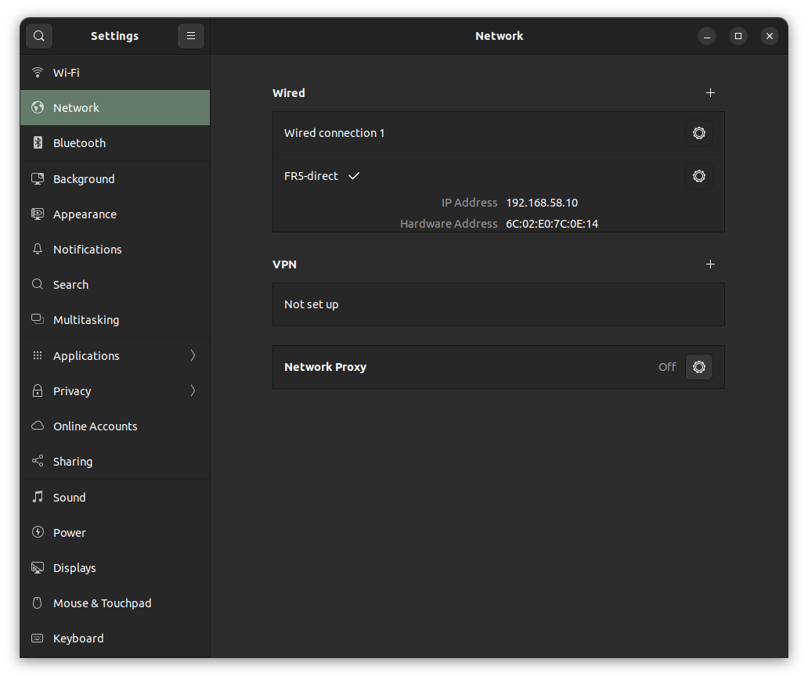
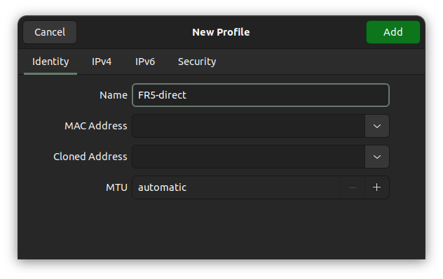
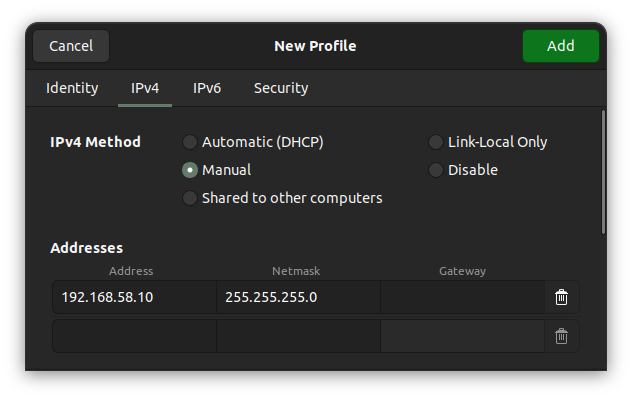

# FAIRINO FR5 MoveIt 2 환경 구성

PC와 FR5를 연결하고 ROS 2 Humble에서 MoveIt 2를 실행한 뒤, 플랜지에 연결된 DH 그리퍼를 ROS 2 서비스로 제어하는 절차입니다.
아래 명령은 Ubuntu 터미널의 Bash 기준입니다.

문서의 네트워크 설정 캡처는 `images/fr5-network/`, 실행 영상은 `videos/`에 포함되어 있습니다. Markdown으로 배포할 때는 이 문서와 이미지·영상의 상대 위치가 유지되도록 `docs` 폴더 전체를 함께 전달합니다.

## 1. 구성 환경 및 사전 준비

| 항목 | 기준 |
|---|---|
| OS | Ubuntu 22.04, x86_64 PC |
| ROS | ROS 2 Humble Desktop |
| 로봇 모델 | FR5 V6.0 |
| 로봇 Web/소프트웨어 버전 | v3.9.3 |
| 확인한 제어기 버전 | V3.9.15-QX |
| 기준 공식 버전 | `V3.0.0_RobotV3.9.3` |
| 사용할 저장소 | `AIRO-lab/frcobot_ros2`의 `main` 브랜치 |
| 작업공간 | `~/fairino_ws` |

이 문서는 위 장비를 기준으로 작성했습니다. 다른 장비에서는 WebApp의 **System → About**에서 모델과 소프트웨어 버전을 먼저 확인하고, 대응하는 드라이버 버전을 선택합니다. 하드웨어 패키지 이름은 `fairino_hardware`입니다. [공식 v3.9.3 릴리스](https://github.com/FAIR-INNOVATION/frcobot_ros2/releases/tag/V3.0.0_RobotV3.9.3)를 기반으로 수정한 [교육용 저장소](https://github.com/AIRO-lab/frcobot_ros2)를 사용합니다.

이 저장소에는 **MoveIt 드라이버의 로봇 연결을 공유하는 그리퍼 서비스**가 추가되어 있습니다. 7절의 MoveIt 연동 방식은 이 수정본을 빌드한 환경을 기준으로 합니다.

### 필요한 패키지 설치

ROS 2 Humble Desktop과 ROS apt 저장소가 이미 설치·설정된 PC에서 실행합니다. MoveIt은 `/opt/ros/humble`의 apt 설치본을 사용합니다. [제조사 MoveIt 설치 안내](https://support.fairino.us/portal/en/kb/articles/getting-started-with-the-fairino-moveit2-plugin)

```bash
sudo apt update
sudo apt install \
  git build-essential cmake python3-colcon-common-extensions \
  ros-humble-moveit \
  ros-humble-ros2-control ros-humble-ros2-controllers \
  ros-humble-xacro ros-humble-joint-state-publisher-gui \
  ros-humble-rosidl-default-generators \
  ros-humble-ament-cmake-gmock \
  ros-humble-ament-lint-auto ros-humble-ament-lint-common
```

### 터미널 환경 준비

다른 ROS 작업공간의 환경이 함께 로드되면 패키지·라이브러리 버전 충돌이 발생할 수 있습니다. `~/.bashrc`에 다른 작업공간을 자동으로 불러오는 줄이 있다면 앞에 `#`를 붙이고 **새 터미널**을 엽니다. 다음은 주석 처리 대상의 예시입니다.

```bash
# source ~/ros2_ws/install/local_setup.bash
# source ~/tetra_ws/install/local_setup.bash
# source ~/ws_moveit/install/setup.bash
# source ~/franka_ros2_ws/install/setup.bash
```

ROS 기본 설정인 `source /opt/ros/humble/setup.bash`는 유지합니다. 기존 터미널에서 `.bashrc`를 다시 불러오는 것만으로는 이미 로드된 환경이 제거되지 않습니다.
프롬프트에 `(base)` 등 Conda 환경이 표시된다면 `conda deactivate`로 해제합니다.

새 터미널에서 확인합니다.

```bash
source /opt/ros/humble/setup.bash
ros2 pkg prefix moveit_ros_move_group
ros2 pkg prefix joint_trajectory_controller
```

두 결과 모두 `/opt/ros/humble`이어야 합니다. 첫 빌드 전에는 `~/fairino_ws/install`이 아직 없으므로 해당 경로를 source하지 않습니다.

## 2. PC–FR5 연결 및 WebApp 로그인

로봇 제어함/버튼박스의 **PC 연결용 LAN 포트**에 PC를 연결합니다. 로봇 내부 통신용 포트와 구분합니다. 아래는 기본 IP `192.168.58.2`를 사용하는 버튼박스 측 연결 기준입니다. [제조사 연결 안내](https://manual.fairino.support/latest/CobotsManual/install_power_robot.html#connect-the-control-box)

로봇용 유선 연결 프로필을 **`FR5-direct`**라는 이름으로 따로 만듭니다. 기존 `Wired connection 1`은 보존하고, FR5를 사용할 때 `FR5-direct`를 선택합니다. 두 항목은 같은 유선 어댑터에서 선택해 사용할 수 있는 서로 다른 설정입니다.

PC에 유선 어댑터가 여러 개라면 로봇에 연결한 어댑터를 선택합니다. 이번 구성에 사용한 PC의 인터페이스 이름은 `eno1`이지만 PC마다 다를 수 있습니다.

### 2-1. Network에서 유선 프로필 추가

Ubuntu **설정(Settings) → 네트워크(Network)**를 열고, 로봇에 연결한 **유선(Wired)** 항목 오른쪽의 **`+`**를 누릅니다.



*그림 2-1. 캡처에는 이미 생성하고 활성화한 `FR5-direct`와 PC 주소 `192.168.58.10`이 보입니다. 처음 설정하는 PC에서는 `+`로 새로 만들고, 이미 `FR5-direct`가 있다면 해당 항목의 톱니바퀴에서 설정을 확인합니다.*

### 2-2. Identity에서 이름 설정

새 프로필의 **Identity** 탭에서 그림처럼 **Name**을 `FR5-direct`로 입력합니다. 나머지 탭 설정까지 마친 후 **Add**를 누릅니다.



*그림 2-2. 프로필 이름을 `FR5-direct`로 지정한 화면입니다. MAC 주소는 로봇에 연결한 PC 어댑터 기준이며, 다른 PC의 주소를 복사하지 않습니다.*

### 2-3. IPv4를 수동 주소로 설정

**IPv4** 탭에서 **IPv4 Method → Manual(수동)**을 선택하고, 그림처럼 PC 주소와 넷마스크를 입력합니다. **Gateway는 비워 둡니다.**



*그림 2-3. 로봇 연결에 사용할 수동 IPv4 주소를 입력한 화면입니다. DNS 항목은 아래로 스크롤해 확인합니다.*

설정값은 다음과 같습니다.

| 설정 | 값 |
|---|---|
| IPv4 Method | `Manual` |
| Address | `192.168.58.10` |
| Netmask | `255.255.255.0` |

`192.168.58.10`은 **PC의 주소**, `192.168.58.2`는 **로봇의 주소**입니다. PC의 Address 칸에 로봇 주소를 입력하지 않습니다.

### 2-4. 나머지 설정 확인 후 저장

- **IPv6** 탭: **Disable**을 선택합니다. 로봇 연결은 IPv4를 사용합니다.
- **Security** 탭: **802.1x Security**를 **끔(Off)**으로 유지합니다.

설정을 마쳤다면 오른쪽 위 **Add**를 눌러 저장합니다. 기존 프로필을 편집 중이라면 저장 버튼이 **Apply**로 표시될 수 있습니다.

## 3. 저장소 다운로드 및 버전 선택

아래는 작업공간과 저장소를 처음 만드는 경우의 명령입니다. 이미 수정본을 내려받아 작업 중이라면 반복할 필요가 없습니다.

```bash
mkdir -p ~/fairino_ws/src
cd ~/fairino_ws/src
git clone --branch main https://github.com/AIRO-lab/frcobot_ros2.git
```

## 4. 하드웨어 설정 세팅

빌드 전에 MoveIt이 사용할 하드웨어 플러그인과 로봇 IP를 설정합니다. 이미 launch를 실행 중이라면 `Ctrl+C`로 종료한 뒤 파일을 수정합니다.

### 플러그인 설정

편집할 하드웨어 설정 파일의 경로는 다음과 같습니다.

```text
~/fairino_ws/src/frcobot_ros2/fairino5_v6_moveit2_config/config/fairino5_v6_robot.ros2_control.xacro
```

공식 원본의 기본값은 아래 가상 로봇용 플러그인입니다. 교육용 저장소에는 실제 드라이버가 이미 선택되어 있으므로 현재 설정을 확인합니다.

```xml
<plugin>mock_components/GenericSystem</plugin>
```

실제 FR5에 연결하려면 위 줄을 주석 처리하고 실제 드라이버를 활성화합니다. `<!-- ... -->`는 XML 주석이며, `<hardware>` 안에서 **주석 처리되지 않은 `<plugin>`은 한 개만** 둡니다.

```xml
<!-- <plugin>mock_components/GenericSystem</plugin> -->
<plugin>fairino_hardware/FairinoHardwareInterface</plugin>
```

실행 대상은 이 설정으로 결정됩니다. 가상 플러그인을 유지하면 가상 로봇을 사용하고, 실제 드라이버를 선택하면 FR5에 연결합니다. 실행 명령은 동일합니다.

### 로봇 IP 확인

드라이버의 IP는 다음 파일에 지정되어 있습니다.

```text
~/fairino_ws/src/frcobot_ros2/fairino_hardware/include/fairino_hardware/fairino_hardware_interface.hpp
```

```cpp
#define CONTROLLER_IP_ADDRESS "192.168.58.2"
```

로봇 IP가 `192.168.58.2`라면 그대로 사용합니다. 다른 IP를 사용한다면 실제 주소로 변경한 뒤 저장합니다.

## 5. Build

1절에서 준비한 터미널에서 4절의 설정을 반영해 필요한 네 패키지를 빌드합니다.

```bash
source /opt/ros/humble/setup.bash
cd ~/fairino_ws
colcon build --symlink-install --packages-select \
  fairino_msgs \
  fairino_hardware \
  fairino_description \
  fairino5_v6_moveit2_config
```

네 패키지 모두 빌드가 완료되고 `Failed` 또는 `Aborted`가 없는지 확인합니다. 이후 하드웨어 설정이나 IP를 변경했다면 위 명령으로 다시 빌드합니다.

## 6. 실행

빌드가 완료되면 다음 명령으로 MoveIt과 RViz를 실행합니다. 새 터미널을 열 때에도 두 줄의 환경 설정을 먼저 불러옵니다.

> 실제 FR5 드라이버를 선택하면 launch 후 활성화 시점부터 주기적으로 제어 명령이 전송됩니다. 작업 공간과 비상정지 접근을 확보하고 담당자와 실행 준비를 확인합니다.

```bash
source /opt/ros/humble/setup.bash
source ~/fairino_ws/install/local_setup.bash
ros2 launch fairino5_v6_moveit2_config demo.launch.py
```

이 문서에서는 `local_setup.bash`를 사용해 FR5 작업공간을 추가합니다. `install/setup.bash`는 빌드 당시 기록된 다른 작업공간까지 불러올 수 있습니다.

RViz에 FR5 모델과 MotionPlanning 패널이 표시되는지 확인합니다. 종료할 때는 launch를 실행한 터미널에서 `Ctrl+C`를 누릅니다.

### 실행 영상

<video controls preload="metadata" style="width: 100%; max-width: 960px;">
  <source src="videos/run.webm" type="video/webm">
</video>

문서에서 영상이 재생되지 않으면 [실행 영상 열기](videos/run.webm)를 선택합니다.

## 7. DH AG95 그리퍼 ROS 2 서비스 제어

### 7-1. 통신 구조 및 설명

FR5 플랜지에 연결된 **DH Robotics AG-160-95-W-S** 그리퍼를 `fairino_hardware` 패키지로 제어합니다. 사용하는 방식에 따라 서비스 제공 프로그램이 달라집니다.

| 사용 방식 | 서비스를 제공하는 프로그램 |
|---|---|
| MoveIt과 함께 사용 | 수정한 `FairinoHardwareInterface` 드라이버의 그리퍼 서비스 |
| MoveIt 없이 그리퍼만 사용 | 기존 `ros2_cmd_server` |

```text
PC의 ROS 2 서비스 호출 (터미널 또는 Python)
    → MoveIt 드라이버의 그리퍼 서비스 또는 ros2_cmd_server 중 하나
    → Ethernet → FR5 제어기 (192.168.58.2)
    → 플랜지 RS485 통신 → DH 그리퍼
```

MoveIt과 함께 사용할 때는 팔 드라이버가 이미 연결한 SDK 인스턴스를 공유합니다. 단독으로 사용할 때는 `ros2_cmd_server`가 로봇에 연결합니다. **두 프로그램을 동시에 실행하지 않습니다.** 각각 로봇에 접속하려 하면 연결 오류가 발생할 수 있습니다.

PC에서 명령을 보내면 FR5 제어기가 플랜지 통신을 통해 그리퍼에 전달합니다. 따라서 **이 제어 방식은 FAIRINO 제어기에 의존합니다.** 여기서 사용하는 `ActGripper()`, `MoveGripper()`는 FAIRINO API입니다. [공식 ROS 2 안내](https://fairino-doc-en.readthedocs.io/3.9.3/ROSGuide/ros2guide.html#quick-start)

두 방식 모두 아래 서비스를 사용합니다. 요청의 `cmd_str`에 명령 문자열을 넣고 응답의 `cmd_res`로 결과를 받습니다. Python에서도 `rclpy` 서비스 클라이언트로 같은 명령을 호출할 수 있습니다.

| 항목 | 값 |
|---|---|
| 서비스 이름 | `/fairino_remote_command_service` |
| 서비스 타입 | `fairino_msgs/srv/RemoteCmdInterface` |
| 활성화 명령 | `ActGripper(그리퍼번호, 활성화여부)` |
| 이동 명령 | `MoveGripper(그리퍼번호, 목표위치)` |

### 7-2. 제어 프로그램 실행 — 터미널 1

앞 절의 **패키지 빌드와 PC–FR5 연결**, WebApp의 **1번 그리퍼 등록**이 끝난 상태를 기준으로 합니다. 터미널에 `(base)`가 표시되면 먼저 `conda deactivate`를 실행합니다.

> 활성화와 이동 명령은 실제 그리퍼를 움직일 수 있습니다. 손과 물체를 그리퍼 사이에서 치운 뒤 실행합니다. MoveIt과 함께 사용할 때 첫 동작 확인은 팔을 정지시킨 상태에서 진행합니다. SDK 응답이 지연되면 팔 제어 주기도 지연될 수 있습니다.

**A. MoveIt과 함께 사용하는 경우**

6절에서 실제 FR5 드라이버로 MoveIt을 이미 실행했다면 그대로 두고 7-3절로 진행합니다. 아직 실행하지 않았다면 다음 명령을 사용합니다.

```bash
source /opt/ros/humble/setup.bash
source ~/fairino_ws/install/local_setup.bash

ros2 launch fairino5_v6_moveit2_config demo.launch.py
```

로그에 `Gripper service ready: /fairino_remote_command_service`가 표시되면 그리퍼 서비스가 준비된 것입니다. **별도의 `ros2_cmd_server`는 실행하지 않습니다.** 속도와 힘의 기본 요청값은 각각 `20%`입니다. 가상 플러그인 `mock_components/GenericSystem`에서는 이 서비스가 생성되지 않습니다.

**B. MoveIt 없이 그리퍼만 사용하는 경우**

MoveIt을 실행 중이라면 launch를 실행한 터미널에서 `Ctrl+C`로 종료한 뒤, 다음 명령으로 단독 서버를 실행합니다. RViz 창만 닫는 것으로는 드라이버가 종료되지 않을 수 있습니다.

```bash
source /opt/ros/humble/setup.bash
source ~/fairino_ws/install/local_setup.bash

ros2 run fairino_hardware ros2_cmd_server --ros-args \
  -p gripper_vel:=20 \
  -p gripper_force:=20
```

로봇 연결 성공 로그를 확인하고 터미널을 켜 둡니다. 이후 MoveIt 방식으로 전환하려면 이 서버를 먼저 종료합니다.

두 방식 모두 위 설정 기준 속도와 힘의 요청값은 각각 `20%`이며, `20 mm/s` 또는 `20 N`을 뜻하지 않습니다. 아래 활성화·이동·상태 조회 명령은 두 방식에서 동일합니다.

### 7-3. 명령 호출 준비 — 터미널 2

```bash
source /opt/ros/humble/setup.bash
source ~/fairino_ws/install/local_setup.bash
```

이후 명령은 모두 터미널 2에서 실행합니다. 응답의 첫 번째 결과 코드가 `0`이 아니면 오류를 확인한 뒤 다음 단계로 진행합니다. 조회가 실패했을 때는 뒤의 상태값을 사용하지 않습니다.

### 7-4. 그리퍼 활성화

```bash
ros2 service call /fairino_remote_command_service \
  fairino_msgs/srv/RemoteCmdInterface \
  "{cmd_str: 'ActGripper(1,1)'}"
```

첫 번째 `1`은 그리퍼 번호, 두 번째 `1`은 활성화를 뜻합니다. `cmd_res='0'`이면 SDK 호출 성공입니다. 이미 활성화되어 있다면 상태 조회부터 진행합니다.

초기화 동작이 끝나면 활성화 상태를 조회합니다.

```bash
ros2 service call /fairino_remote_command_service \
  fairino_msgs/srv/RemoteCmdInterface \
  "{cmd_str: 'GetGripperActivateStatus()'}"
```

현재 장비에서 단독 명령 서버로 확인한 응답은 `cmd_res='0,0,1'`입니다. 순서대로 **조회 성공, 고장 없음, 활성화 비트마스크 1(bit 0 켜짐)**을 의미합니다. 마지막 값은 그리퍼 번호나 이동 완료 여부가 아닙니다.

### 7-5. 그리퍼 위치 제어

1번 그리퍼를 SDK 기준 목표 위치 50%로 이동시킵니다.

```bash
ros2 service call /fairino_remote_command_service \
  fairino_msgs/srv/RemoteCmdInterface \
  "{cmd_str: 'MoveGripper(1,50)'}"
```

- `1`: WebApp에 등록한 그리퍼 번호
- `50`: 목표 위치 백분율. 입력 범위는 `0~100`이며 mm나 관절 각도가 아닙니다.

속도와 힘은 7-2절 기준 각각 `20%`입니다. 위치값을 바꿀 때는 실제 열림·닫힘 방향과 위치 피드백을 확인하며 진행합니다.

응답 `cmd_res='0'`은 SDK 호출 성공을 의미하며, 실제 동작 완료는 다음 단계에서 확인합니다.

### 7-6. 동작 완료 및 현재 위치 확인

**동작 완료 조회:**

```bash
ros2 service call /fairino_remote_command_service \
  fairino_msgs/srv/RemoteCmdInterface \
  "{cmd_str: 'GetGripperMotionDone()'}"
```

| 응답 예시 | 의미 |
|---|---|
| `0,0,0` | 조회 성공, 고장 없음, 동작 미완료 |
| `0,0,1` | 조회 성공, 고장 없음, 동작 완료 |

동작 미완료라면 잠시 후 다시 조회합니다. 이 명령의 마지막 값은 **동작 완료 여부**이며, 활성화 조회의 마지막 값과 의미가 다릅니다.

**현재 위치 조회:**

```bash
ros2 service call /fairino_remote_command_service \
  fairino_msgs/srv/RemoteCmdInterface \
  "{cmd_str: 'GetGripperCurPosition()'}"
```

응답은 `결과코드,고장상태,현재위치(%)` 순서입니다. 예를 들어 `0,0,50`이면 조회 성공, 고장 없음, 위치 피드백 50%입니다. 위 완료·위치 응답은 해석을 위한 예시이며 실제 움직임과 함께 확인합니다. [공식 그리퍼 API 설명](https://fairino-doc-en.readthedocs.io/3.9.3/SDKManual/PythonRobotPeripherals.html)

사용을 마치면 팔과 그리퍼가 정지한 것을 확인하고, 터미널 1에서 `Ctrl+C`로 실행 중인 MoveIt 또는 단독 명령 서버를 종료합니다.
